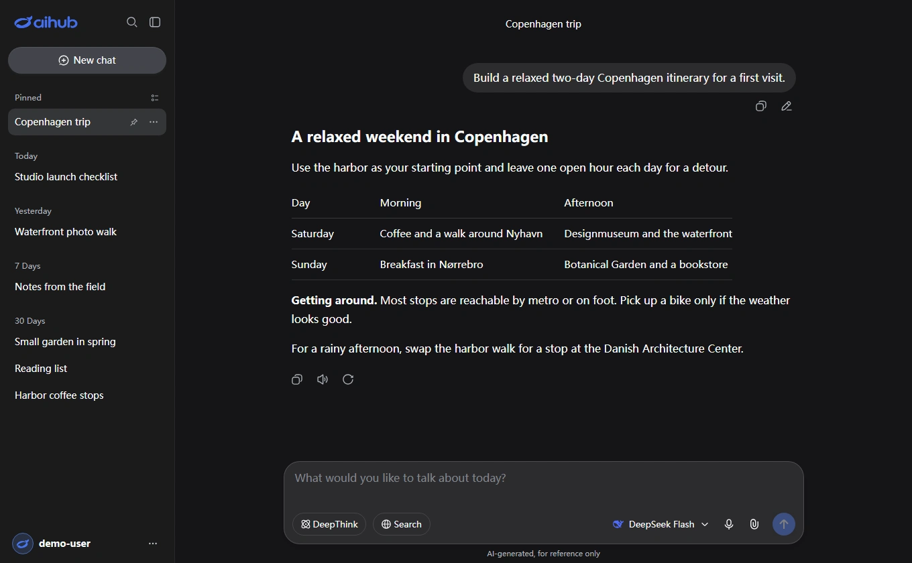
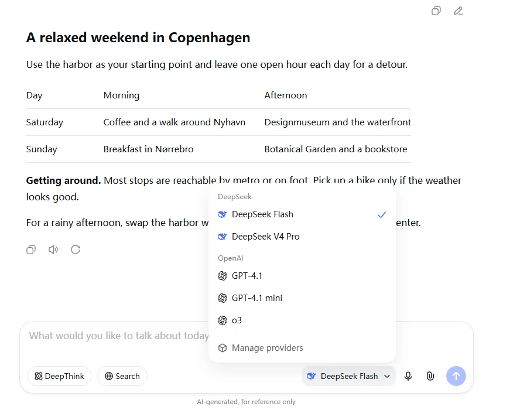
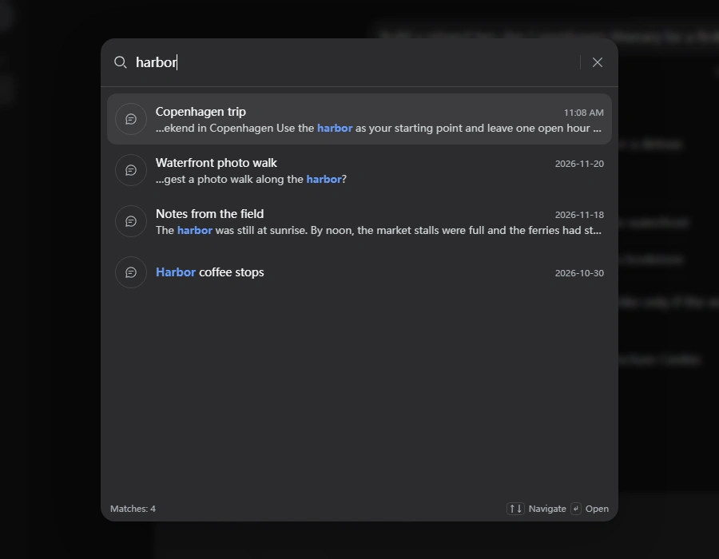
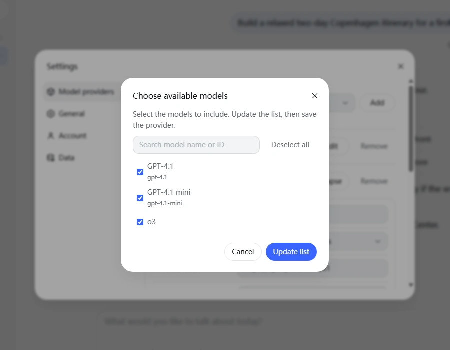
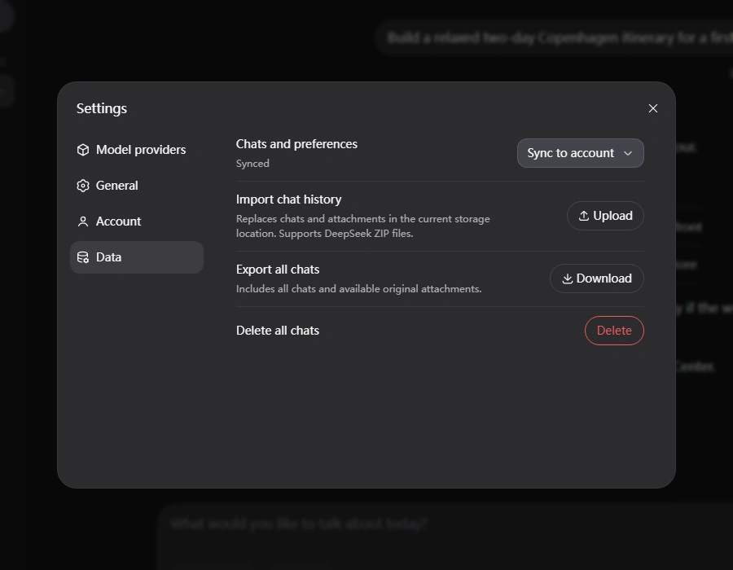

<p align="center">
  
</p>

<h1 align="center">AI Hub</h1>

<p align="center"><strong>A self-hosted chat workspace for DeepSeek and OpenAI-compatible models.</strong></p>

<p align="center">
  English · <a href="README.zh-CN.md">简体中文</a> ·
  <a href="#quick-start">Quick start</a> ·
  <a href="https://github.com/ApakohZzz/AIHub-deepseek-chatdemo-modified/releases">Releases</a> ·
  <a href="LICENSE">MIT</a>
</p>

<p align="center">
  <a href="docs/screenshots/chat-dark.webp"></a>
</p>

AI Hub builds on [DeepSeek Chat Demo v0.1.2](https://github.com/deepseek-ai/chat-demo/tree/v0.1.2). It adds multi-provider chat, searchable history, and an optional account server that keeps your workspace available across devices.

## What AI Hub adds

| | DeepSeek Chat Demo v0.1.2 | AI Hub |
| --- | --- | --- |
| **Providers and models** | DeepSeek API | DeepSeek and OpenAI Chat Completions-compatible profiles, editable model catalogs, model discovery, and a picker in the composer |
| **Conversation library** | Create, rename, delete, and import or export chats | Search chat titles and active-branch messages with highlighted snippets and keyboard navigation. Select multiple chats to pin, unpin, or delete |
| **Accounts and credentials** | API key stored in the browser | Browser-only credentials or optional Gitea sign-in with encrypted, per-account provider credentials |
| **Cross-device workspace** | History stored in the browser | Sync chats, message branches, available original attachments, drafts, pins, and preferences. Offline changes queue locally and concurrent chat edits keep a conflict copy |
| **History portability** | DeepSeek history ZIP import and export | Import DeepSeek history ZIPs. AI Hub exports also preserve model and provider references, pins, and available original attachments |

Streaming replies, editing and regeneration, light and dark themes, Markdown, formulas, Mermaid diagrams, and attachment previews remain available. Reasoning controls, web search, voice, and supported file types depend on the model and provider.

## Screenshots

| Model switching | Conversation search |
| --- | --- |
| [](docs/screenshots/model-picker.webp) | [](docs/screenshots/conversation-search.webp) |
| Switch models from the composer. Each chat remembers its selection. | Search titles and message text with **Ctrl/Cmd + K** and use **Enter** to open a result. |
| **Model discovery** | **Account sync** |
| [](docs/screenshots/model-catalog.webp) | [](docs/screenshots/account-sync.webp) |
| Fetch available models, choose which to show, and configure display names and model limits. | Choose between account sync and browser-only storage in **Settings → Data**. |

Screenshots were captured from the running app with a sample account, conversations, and mocked provider responses.

## Quick start

### Web · Browser storage

1. Extract the **Web ZIP** from Releases, or build it from source below.
2. Serve the extracted files on a static web server over HTTPS. A loopback HTTP address works for local testing.
3. Open **Settings → Model providers**. Add DeepSeek or an OpenAI-compatible endpoint, enter your API key, and choose which models to show. The provider must allow cross-origin requests from your web app.

Keys and settings are saved in the browser. Conversations and original attachments are stored in IndexedDB. When you send a message, the browser calls your configured provider directly.

### Server · Gitea login and sync

Use the **Server ZIP** for Gitea sign-in and a synced workspace. It includes the Web app and a Node.js 24 account service backed by SQLite. Register a confidential OAuth application on your Gitea instance and configure the exact callback URL and allowed usernames. The server encrypts synced data and keys at rest and proxies account-saved providers only to configured endpoints. [Account server guide](server/README.md)

### Build from source

Use **Node.js 24** and **pnpm 9.15.9**.

```sh
pnpm install --frozen-lockfile
pnpm dev
```

Open `http://127.0.0.1:8090`. To build and package both distributions, run the following commands.

```sh
pnpm build
pnpm package
```

The site is in `dist/`. Both ZIPs and their SHA-256 files are in `artifacts/`. Run `pnpm type`, `pnpm test`, and `pnpm test:server` for regression checks. After building, `pnpm test:browser` runs Chromium-based end-to-end tests.

## License and upstream

AI Hub is an independent project based on [deepseek-ai/chat-demo](https://github.com/deepseek-ai/chat-demo). The original copyright and license notice are retained under the [MIT license](LICENSE).
