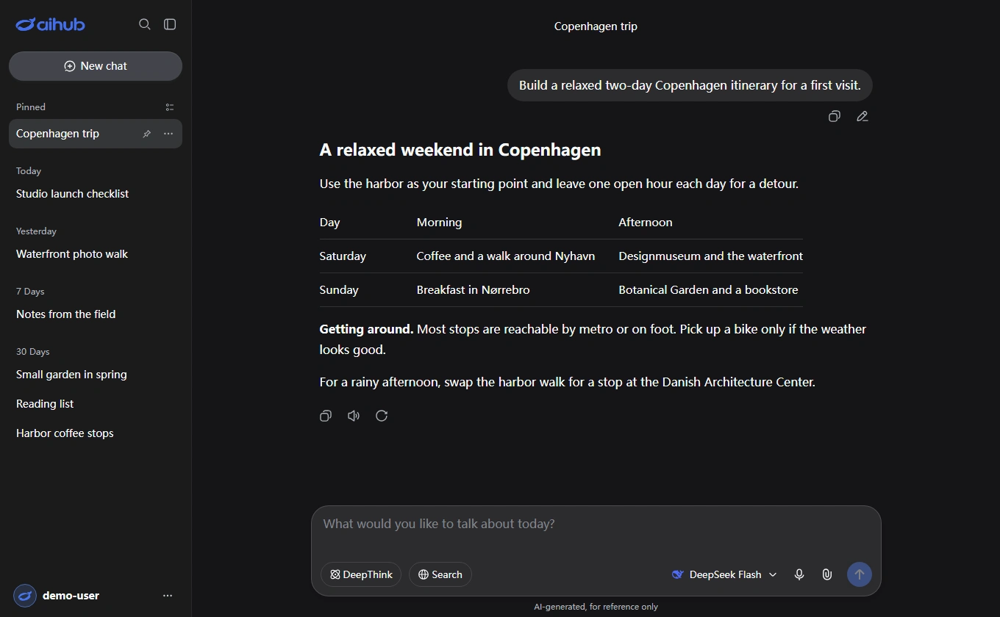
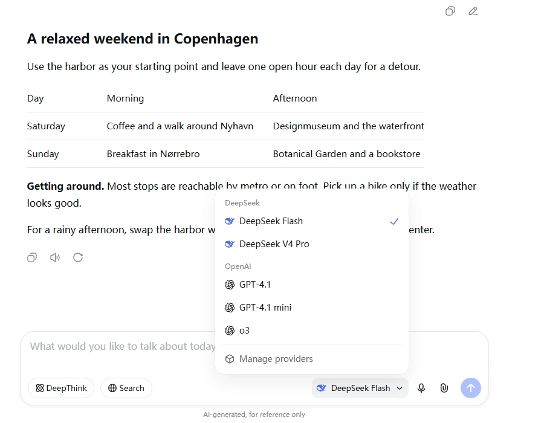
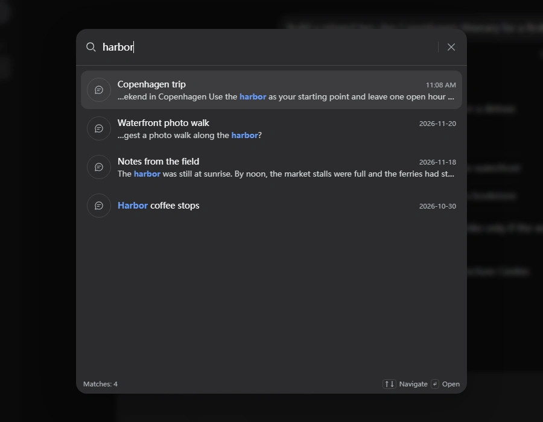
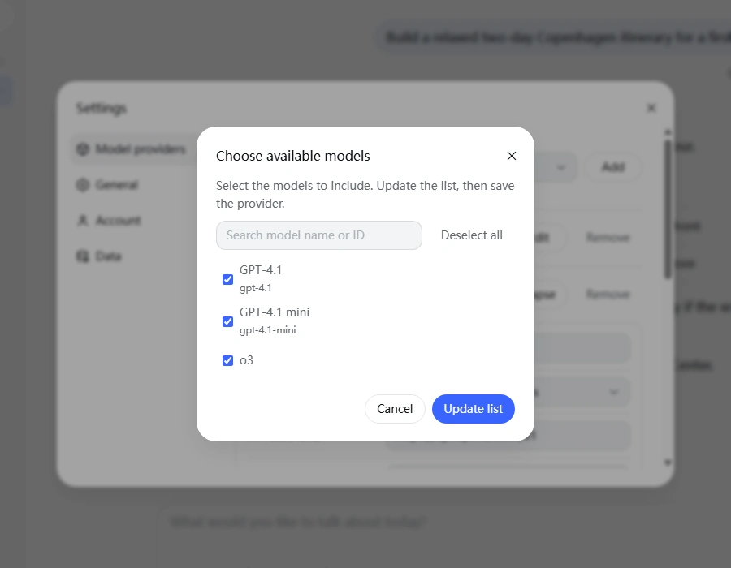
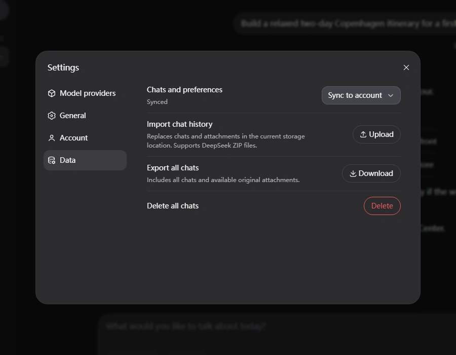

<p align="center">
  
</p>

<h1 align="center">AI Hub</h1>

<p align="center"><strong>可自托管的多模型聊天工作台，支持 DeepSeek 和 OpenAI 兼容接口。</strong></p>

<p align="center">
  <a href="README.md">English</a> · 简体中文 ·
  <a href="#快速开始">快速开始</a> ·
  <a href="https://github.com/ApakohZzz/AIHub-deepseek-chatdemo-modified/releases">版本下载</a> ·
  <a href="LICENSE">MIT</a>
</p>

<p align="center">
  <a href="docs/screenshots/chat-dark.webp"></a>
</p>

AI Hub 基于 [DeepSeek Chat Demo v0.1.2](https://github.com/deepseek-ai/chat-demo/tree/v0.1.2)，加入多供应商接入、会话全文搜索，以及可选的 Gitea 登录与跨设备同步。

## 相比上游新增了什么

| | DeepSeek Chat Demo v0.1.2 | AI Hub |
| --- | --- | --- |
| **供应商和模型** | DeepSeek API | DeepSeek 与 OpenAI Chat Completions 兼容配置，支持获取可用模型、编辑模型目录，在聊天输入框直接切换模型 |
| **会话管理** | 新建、重命名、删除和历史导入导出 | 搜索标题和当前分支的消息正文，高亮匹配片段，支持键盘打开结果。多选会话后可批量置顶、取消置顶或删除 |
| **账号与凭据** | API Key 保存在浏览器 | 可在浏览器单独保存，也可用 Gitea 登录，将供应商配置和 Key 加密保存到个人账号 |
| **跨设备工作区** | 历史保存在浏览器 | 同步会话、消息分支、可用的附件原件、草稿、置顶状态和偏好。离线改动先保存在本地，并发编辑保留冲突副本 |
| **历史迁移** | DeepSeek 历史 ZIP 导入导出 | 可导入 DeepSeek 历史 ZIP，AI Hub 导出还会保留供应商和模型引用、置顶状态及可用的附件原件 |

继续支持流式回复、编辑与重新生成、明暗主题、Markdown、公式、Mermaid 和附件预览。深度思考、联网搜索、语音和支持的文件类型取决于模型与供应商。

## 站点截图

| 模型切换 | 会话搜索 |
| --- | --- |
| [](docs/screenshots/model-picker.webp) | [](docs/screenshots/conversation-search.webp) |
| 各会话记住自己的供应商与模型，输入框内可直接切换。 | 按 **Ctrl/Cmd + K** 搜索标题和消息正文，按 **Enter** 打开结果。 |
| **模型发现** | **账号同步** |
| [](docs/screenshots/model-catalog.webp) | [](docs/screenshots/account-sync.webp) |
| 拉取供应商的模型列表，勾选常用模型，并设置显示名和模型参数。 | 在 **设置 → 数据管理** 选择账号同步或仅此浏览器。 |

图片截自实际运行的 AI Hub，使用示例账号、示例会话和模拟供应商数据。

## 快速开始

### Web · 仅浏览器存储

1. 下载并解压 **Web ZIP**，也可按下方步骤从源码构建。
2. 通过 HTTPS 静态站点提供文件。本机测试可使用回环地址上的 HTTP 服务。
3. 打开 **设置 → 模型供应商**，添加 DeepSeek 或 OpenAI 兼容接口，填入自己的 API Key，再选择要显示的模型。供应商接口需要允许站点发起跨域请求。

浏览器保存 Key 和设置，会话及附件原件保存在 IndexedDB。发送消息时，浏览器直接调用所配置的供应商接口。

### Server · Gitea 登录与同步

**Server ZIP** 包含 Web 文件和基于 Node.js 24 与 SQLite 的账号服务。在自己的 Gitea 创建机密 OAuth 应用，登记完整回调地址并配置允许登录的用户名。服务端加密存储同步数据和 Key，账号供应商请求仅代理到已配置的地址。 [账号服务部署文档](server/README.md)

### 从源码构建

使用 **Node.js 24** 和 **pnpm 9.15.9**。

```sh
pnpm install --frozen-lockfile
pnpm dev
```

打开 `http://127.0.0.1:8090`。执行下列命令构建并打包两种版本。

```sh
pnpm build
pnpm package
```

静态站点位于 `dist/`，两个 ZIP 及 SHA-256 校验文件位于 `artifacts/`。用 `pnpm type`、`pnpm test` 和 `pnpm test:server` 运行回归检查。完成构建后，`pnpm test:browser` 运行 Chromium 浏览器回归。

## 许可与上游

AI Hub 是基于 [deepseek-ai/chat-demo](https://github.com/deepseek-ai/chat-demo) 开发的独立项目，沿用 [MIT 许可证](LICENSE)，保留上游版权和许可证声明。
